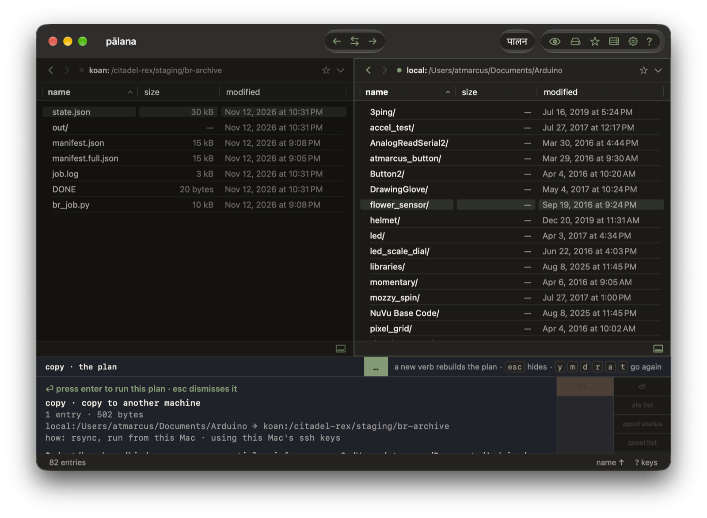

# pālana

*Tend your field.*

pālana is a two-pane Mac file manager for the machines you run yourself. Open a folder on your Mac in one pane and an SSH host in the other, or point both panes at servers. Select a file and press `y` to see where the copy will go, which machine will carry the data, and the commands that will run. Press Enter to run the plan or Esc to dismiss it.

[Get pālana 1.0.0](https://payhip.com/b/YZKXE) for macOS 14 or later on Apple silicon or Intel. The signed and notarized app costs US $29 and includes all 1.x updates. You can also [build it from source](#development) under GPL-3.0.

In the [narrated tour](https://palana.sageframe.net/#tour), Andrew Marcus copies a file directly between two test hosts, takes a ZFS snapshot, and opens a shell on the destination.

<p align="center">
  <br>
  <em>A copy from koan to samu runs host to host, with progress.</em>
</p>

<p align="center">
  <br>
  <em>A copy plan shows the destination and command before you press Enter.</em>
</p>

<p align="center">
  <br>
  <em>On a ZFS host, Z opens the dataset tree.</em>
</p>

---

## Copying and moving files

A disk, network share, or cloud drive mounted on your Mac is a local path in pālana. For example, a copy from an SMB share under `/Volumes` to an external disk runs on your Mac. On an SSH host, a copy between two directories runs on that host.

Between two SSH hosts, files can travel directly from source to destination. The source needs rsync 3.1 or later, the destination needs rsync, and the source must be able to log in to the destination using your forwarded SSH agent. Forwarding lets the source ask the agent on your Mac to authenticate without copying your private key to the server. If this route is unavailable, pālana can stream a file copy through your Mac with tar. It refuses a file move that would need that fallback.

A move uses `mv` when pālana can establish that both paths are on one filesystem and no directories need to merge. Otherwise, a file move requires rsync. With `--checksum --remove-source-files`, rsync compares file contents and removes each source file once its destination copy matches. Leave both locations alone during the move. If it stops, some files may already have moved. Check both locations and read the panel for any selected source paths that remain.

For an rsync move, pālana requests extended attributes, including Finder tags, when both endpoints support them. It requests access control lists (ACLs), which grant permissions to specific users or groups, when both endpoints support them and use the same operating system. The plan names metadata the move cannot preserve.

If an rsync *copy* stops, run the same copy again to reuse data already received. The incomplete file stays in a hidden `.palana-partial` directory at the destination. Rsync skips directories with that reserved name inside a selection. pālana refuses custom copy flags that override this behavior, including `--partial`, `--inplace`, `--append`, `-P`, `--whole-file`, and `--remote-option`.

## Working in the panes

Press `f` for the **field card**, a list of your Mac and the hosts in your SSH config. Each host shows when pālana last checked it, which tools it found, and any ZFS pools and datasets it read. Press `r` on a row to check that host again or Enter to open it in the focused pane. Press `F` for the larger host map, which also shows mounts.

You can mark entries with Space, Shift-click a range, or Command-click individual rows. Drag between panes or from Finder to prepare a copy, or hold Command to prepare a move. Local panes refresh when their directories change. Remote panes refresh every ten seconds while the app is in the foreground.

Press `v` to preview the file under the left cursor in the right pane. Text previews show up to 256 KiB. For remote images, PDFs, and SVG files, the preview fetches at most 25 MiB. Press `` ⌘` `` to open a shell on the focused host. Press it again to return the keyboard to the panes. Each host keeps its own shell session.

Open a remote file to edit a local copy in its Mac application. By default, saving sends the edit back automatically if the remote file still matches the version you opened. A changed or missing file requires confirmation. Settings can require confirmation for every upload. If the destination does not support hard links, the panel offers a replacement by rename and explains the risk of overwriting a concurrent edit.

## Working with ZFS

On a remote ZFS host, press `Z` to browse the dataset tree. A dataset is a filesystem or volume that ZFS manages as a unit. The pane has commands for datasets, snapshots, and mountpoints. Review the proposed change in the plan panel before running it.

When you select a whole dataset and the destination is a dataset mountpoint on another ZFS host, pālana can send a recursive snapshot with `zfs send -R`. The stream travels directly between hosts or through the Mac, depending on SSH access. The receiving host uses `zfs receive -u`, which leaves the new dataset unmounted.

For a dataset move, pālana unmounts the source tree before taking the snapshot. Before destroying the source, it checks that the destination dataset exists and that every source dataset reports zero bytes written since its snapshot. If it cannot establish that, it keeps the source. You may need to mount the retained source again.

## Following a run

Before a transfer, the plan panel lists the source, destination, entry count, size, and commands. It identifies files that would be replaced and directories that would merge. If it cannot inspect the destination, it says that conflicts are unknown. After you press Enter, the panel shows each command and its output. Rsync and ZFS transfers show a progress indicator when the tool reports progress. You can also open the run history with ⇧⌘L. pālana stores it at `~/Library/Application Support/palana/operations.log`.

If you quit during a transfer or while saved edits are waiting to upload, choose **Keep Running**, **Quit When Finished**, or **Stop and Quit**. Quit When Finished waits for outstanding work, including queued saves. If a transfer fails or stops, pālana stays open and holds the remaining saves. Dismiss the failed plan to release them, or choose Quit When Finished again to send them and then quit.

## Known issues

- After a row drag, the window can occasionally stop taking clicks; quitting and reopening pālana recovers it. [#4](https://github.com/sageframe-no-kaji/palana/issues/4)
- Dragging files into Finder copies them; holding ⌘ does not move them. [#6](https://github.com/sageframe-no-kaji/palana/issues/6)
- Remote files cannot be dragged straight into other apps; copy them to a local pane first. [#7](https://github.com/sageframe-no-kaji/palana/issues/7)
- A move run as a non-root user does not keep file ownership. [#9](https://github.com/sageframe-no-kaji/palana/issues/9)
- When a send-back transfer fails, its staging folder stays in the remote directory; the panel names it. [#8](https://github.com/sageframe-no-kaji/palana/issues/8)
- On disks without hard links (exFAT, some SMB shares), the replace-by-rename offer can overwrite a file written between its check and its rename; the panel says so before you choose it. [#11](https://github.com/sageframe-no-kaji/palana/issues/11)

All open issues are in the [issue tracker](https://github.com/sageframe-no-kaji/palana/issues).

## Keys

Press `?` to open the key reference in the app. The [online reference](https://palana.sageframe.net/keys/) includes the ZFS controls.

### Navigation

| key | action |
|---|---|
| `j` / `k`, `↓` / `↑` | cursor down / up |
| `h` / `l`, `←` / `→` | parent directory / enter directory |
| `Enter` | open the directory or file |
| `Space` | select and advance |
| `Tab` | switch pane |
| `/` | jump to a name |
| `.` | show or hide dotfiles |

### File operations

| key | verb |
|---|---|
| `y` | copy to the other pane |
| `m` | move to the other pane |
| `d` | delete permanently (does not use the Trash) |
| `r` | rename |
| `a` | create (a trailing `/` creates a directory) |
| `t` | touch (update the modification time) |

For rename and create, Enter accepts the name. Review the resulting plan and press Enter again to run it.

### Panels

| key | surface |
|---|---|
| `f` | field card |
| `F` | host map (floating panel) |
| `*` | favorites panel |
| `v` | preview in the right pane |
| `` ` `` | plan panel |
| `` ⌘` `` | shell for the focused host |
| `?` | key reference (floating panel) |
| `⌘,` | settings |

### App controls and favorites

| key | action |
|---|---|
| `⌘R` | refresh |
| `⌘← / ⌘→` | back / forward |
| `⌘+ / ⌘− / ⌘0` | zoom in / out / reset |
| `⌘K` | clear the plan panel's transcript |
| `⇧⌘G` | go to `host:path` |
| `⇧⌘L` | open the operations log |
| `8` | star the highlighted entry |
| `⇧⌘8` | star this folder |
| `⌘1 – ⌘9` | open favorite 1–9 in this pane (in the favorites panel's order) |

In the favorites panel, drag a favorite or press `⌥↑` / `⌥↓` to reorder it within its group. `⌘Z` undoes the last change.

### Navigation and clipboard shortcuts

| keys | action |
|---|---|
| `c c / c d / c f / c n` | copy the path · directory · filename · name without extension |
| `, n / , s / , m` | sort by name · size · modified (repeat to reverse) |
| `g g / G` | top / bottom |

In ZFS mode, `c`, `x`, and `r` create, destroy, and rename datasets. For snapshots, `n` creates one, `k` destroys one, and `b` rolls back to one. Use `p` or `i` to set or inherit a mountpoint and `m` or `u` to mount or unmount a dataset.

With the plan panel focused (⇧Tab), `d`, `z`, `s`, and `p` run `df -h`, `zfs list`, `zpool status`, and `zpool list` respectively.

## Requirements

pālana runs on macOS 14 or later. For local folders and mounted volumes, you can start without configuring SSH. For a remote pane, use a host alias in `~/.ssh/config`. In Terminal, replace `myserver` with that alias and run `ssh -o BatchMode=yes myserver true`. A zero exit status means SSH connected and ran the command without a login prompt.

pālana detects rsync and selects flags for the installed version. On the Mac, rsync 3.1 or later adds progress reporting and protects remote path arguments from shell interpretation. Homebrew users can install it with `brew install rsync`. When rsync is unavailable, a same-host copy can use `cp -a`, and a copy over SSH can use tar. These fallback routes do not report transfer progress.

Remote hosts can use GNU, BSD, or BusyBox command-line tools. ZFS is optional and runs on the hosts that hold the datasets. The SSH user needs permission for each ZFS operation. On Linux, mounting and unmounting also require a passwordless sudo rule. See the [mount grant](https://palana.sageframe.net/sudo/).

## How it works

The Swift package has two products. **PalanaCore** discovers hosts, reads directories, parses addresses, composes plans, runs transfers, and checks results. **Palana** is the SwiftUI and AppKit application. It manages windows, input, directory refresh, remote editing, and the per-host terminals built with [SwiftTerm](https://github.com/migueldeicaza/SwiftTerm).

The Field keeps dated observations about hosts. The plan engine takes those facts and a request and returns a plan without contacting a machine. This lets tests check the commands for a proposed operation before any process runs. The Conduit runs remote commands through the system SSH client and reuses connections. The Workbench uses these components for its built-in system queries and ZFS commands.

For the reasoning behind these boundaries, read the [system design](ho-process/kamae-2-palana-system-design.md). The current app runs one plan at a time and loads only its built-in tools. Ideas for later versions include an operations queue, tools for configuration deployment and backup state, a view of services on each host, and browsing a file’s history across ZFS snapshots. The launch-time update check links to the website. Automatic installation remains a proposal.

## Development

Use a Swift 6 toolchain on macOS. From Terminal, clone the repository and build the package.

```sh
git clone https://github.com/sageframe-no-kaji/palana.git
cd palana
swift build
```

Run `swift run Palana` to open the app from the checkout. The [contributor guide](CONTRIBUTING.md) describes the checks and fixtures for patches. The [release guide](RELEASING.md) covers packaging, signing, and notarization.

## License and project

pālana is free to build under [GPL-3.0](LICENSE). It is the first tool in Kṣetra-Ops, Andrew Marcus’s suite for tending homelab infrastructure. Its guiding principle is *bīja*: you should be able to see what acts on your machines. In pālana, you can read the proposed command, see which host runs it, and follow its output.

The [public build record](ho-process/README.md) follows the work from the seed and system design through implementation with AI coding agents and the author’s hands-on interface sessions. pālana (पालन) means tending, nurturing, and sustaining. It is a [Sageframe](https://atmarcus.net) project built with the [Ho System](https://github.com/sageframe-no-kaji/ho-system).
