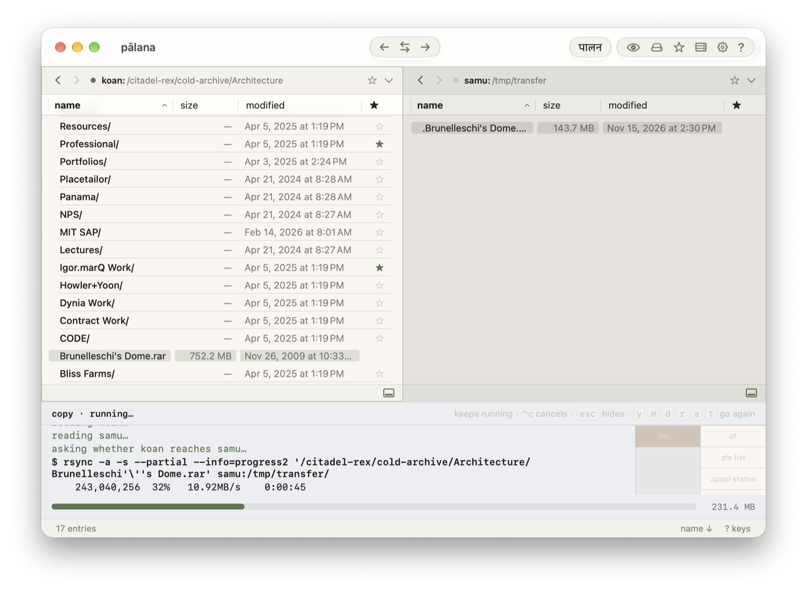
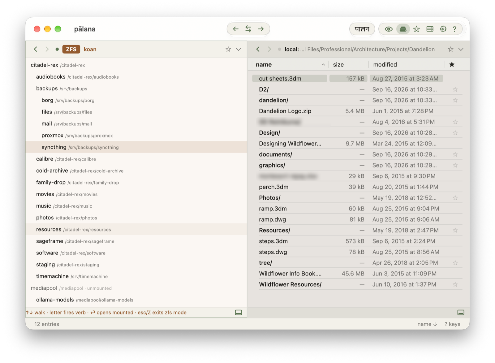

# pālana

*Tend your field.*

pālana is a native Mac file manager for the machines you run yourself. It has two panes, and each pane can show this Mac or any host in your `~/.ssh/config`. Anything mounted on this Mac is a local path, so network shares (SMB, NFS), external disks, and cloud drives that macOS mounts appear in a local pane and are planned the same way. Before a file operation runs, pālana composes a plan and shows it to you: what will change, which machine will carry the data, and the exact commands. Press Enter to run the plan, or Esc to dismiss it. When the hosts support it, a transfer between two servers runs directly from one to the other, and your Mac sends only the command. On hosts that have ZFS, pālana also shows datasets and snapshots and plans ZFS operations the same way.

**Status:** v1.0, the first full release. A signed and notarized universal app for macOS 14 or later. The source is open under GPL-3.0.

**Get pālana:** the app is at [palana.sageframe.net](https://palana.sageframe.net). The build costs US $29 once and includes all 1.x updates. There is no account, license key, or activation. Building from source is free at every version; see [Development](#development). Report bugs and send feedback through the [issue tracker](https://github.com/sageframe-no-kaji/palana/issues).

<p align="center">
  <br>
  <em>A copy from koan to samu runs host to host, with progress.</em>
</p>

<p align="center">
  <br>
  <em>Every operation shows its plan before you press Enter.</em>
</p>

<p align="center">
  <br>
  <em>On a ZFS host, Z opens the dataset tree.</em>
</p>

---

## What pālana does

- **Plans before actions.** Copy, move, delete, rename, create, and touch each compose a plan before anything runs. The plan shows the number of entries and their total size, what kind of operation it is (for example, a move on the same disk, a move across storage boundaries, or a move to another machine), the source and destination, any destination entries it would replace or merge, how the data travels and authenticates, and every command in the order it will run. Enter runs the plan. Esc dismisses it.
- **Mounted storage.** The local pane shows any path on this Mac, including network shares in `/Volumes` and cloud storage mounted under `~/Library/CloudStorage`. Copies and moves to, from, and between them run on the Mac with rsync, or `mv` within one filesystem, and the plan shows which.
- **Server-to-server transfers.** A copy or move between two SSH hosts runs on the source host and sends the data directly to the destination when three conditions hold: the source has rsync 3.1 or later, the destination has rsync, and the source can authenticate to the destination through your forwarded SSH agent. Agent forwarding lets the source host ask your Mac's SSH agent to sign the login, so your private key stays on the Mac. When those conditions do not hold, a copy streams through your Mac with tar, and a move that needs a copy is refused. You do not choose the route. The plan names it.
- **Moves that remove the source.** A move within one filesystem uses `mv`. A move across filesystems, datasets, or hosts uses rsync with `--checksum --remove-source-files`: rsync compares file contents and removes each source file after it transfers that file. pālana then removes the empty source directories and names any source entry that remains. Before you press Enter, the plan warns you not to modify either location during the move, because an interruption can leave files split between them. A move keeps extended attributes and Finder tags (`-X`) when both rsyncs support them, and ACLs (`-A`) between hosts of the same OS; otherwise the plan names what will not be kept. If the transfer fails or is cancelled, pālana still names every selected source that remains.
- **ZFS where ZFS exists.** On hosts with ZFS, pālana reads datasets and mountpoints and uses them to decide what kind of move an operation is. When the selection is a whole dataset and the destination directory is a dataset mountpoint on another ZFS host, a copy or move uses `zfs send -R` piped into `zfs receive -u` instead of copying files. `Z` switches a pane to the host's dataset tree, where you can create, destroy, rename, snapshot, and roll back, set or inherit mountpoints, and mount or unmount. Each of these is a plan. Hosts without ZFS show none of it.
- **The field.** `f` opens a card that lists this Mac and each host from your SSH config, with its reachability, the age of its facts, its userland (GNU, BSD, or BusyBox), whether it has rsync, ZFS, and passwordless sudo, and its pools and datasets. Enter on a row points the focused pane there and closes the card. `F` opens a floating host map that adds each host's mounts. pālana reads these facts when you ask (`r` on a host row). Nothing probes on a schedule.
- **Panes that stay current.** A local pane watches its directory and refreshes when it changes. A remote pane re-lists every ten seconds while the window is frontmost.
- **The plan panel.** Before Enter, the panel at the bottom of the window shows the plan. After Enter, it shows each command as it starts and streams its output, with a progress bar when rsync or `zfs send` reports progress. You can compare the commands you approved with the commands that ran. Each enacted run is also appended to `~/Library/Application Support/palana/operations.log`.
- **A shell per host.** `` ⌘` `` opens an interactive terminal for the focused host in the panel, through your own `ssh`, so full-screen programs such as vim and htop work. Each host keeps its own shell. `` ⌘` `` moves the keyboard between the shell and the panes.
- **Preview.** `v` turns the right pane into a preview of the file under the left pane's cursor: text (up to the first 256 KB) in a scrollable monospace view, images and PDFs through Quick Look, and an information card for every file. Remote text, images, PDFs, and SVG files are previewed too; remote binary files are fetched only when they are 25 MB or smaller.
- **Remote editing.** Opening a remote file copies it to a local folder and opens it in its Mac application. When you save, pālana uploads the change if the remote file has not changed since it was fetched. A changed or missing remote file always asks first. Settings can require confirmation for every upload. On a destination that cannot make hard links (exFAT, many FUSE mounts, some SMB shares), the safe replace refuses with nothing changed, and pālana offers to replace by rename instead and says what that risks.
- **Drag out to other apps.** Drag local files and folders, including a multi-row selection, into Finder, a browser upload box, or Mail. Finder receives a copy; ⌘-drag to move is tracked in [#6](https://github.com/sageframe-no-kaji/palana/issues/6). Remote files and folders drag between pālana's panes. To send a remote file to another app, copy it to a local pane first. An intermittent freeze after a row drag on macOS 27 is tracked in [#4](https://github.com/sageframe-no-kaji/palana/issues/4), with the investigation in [`docs/known-issues/drag-freeze.md`](docs/known-issues/drag-freeze.md).
- **Favorites, drag and drop, and settings.** Star folders and open them with `⌘1`–`⌘9`. Drag entries between panes, or from Finder, to compose a copy plan; hold ⌘ to compose a move. Mouse selection follows Finder: Shift-click selects a range, and ⌘-click adds or removes a row. Settings add or hide hosts in your SSH config, set rsync exclusions and extra flags, and choose the appearance. `⌘+`, `⌘−`, and `⌘0` zoom the whole window.

## Keys

The keys follow five rules: lowercase letters are verbs, `r` and `a` open a name field, a small set of keys open surfaces, `⌘` belongs to the app, and a few prefixes start two-key sequences. Press `?` in the app for the same reference in a floating panel. The full map is at [palana.sageframe.net/keys](https://palana.sageframe.net/keys/).

**navigate**

| key | action |
|---|---|
| `j` / `k`, `↓` / `↑` | cursor down / up |
| `h` / `l`, `←` / `→` | parent directory / enter directory |
| `Enter` | open the directory or file |
| `Space` | select and advance |
| `Tab` | switch pane |
| `/` | jump to a name |
| `.` | show or hide dotfiles |

**verbs.** A lowercase letter states an intent, and the plan panel opens before anything runs.

| key | verb |
|---|---|
| `y` | copy to the other pane |
| `m` | move to the other pane |
| `d` | delete permanently (does not use the Trash) |
| `r` | rename |
| `a` | create (a trailing `/` creates a directory) |
| `t` | touch (update the modification time) |

**names.** `r` and `a` open the name field. `⏎` commits the name and composes the plan.

**surfaces**

| key | surface |
|---|---|
| `f` | field card |
| `F` | host map (floating panel) |
| `*` | favorites panel |
| `v` | preview in the right pane |
| `` ` `` | plan panel |
| `` ⌘` `` | shell for the focused host |
| `?` | key reference (floating panel) |
| `⌘,` | settings |

**app.** `⌘` keys act on the app, never on files.

| key | action |
|---|---|
| `⌘R` | refresh |
| `⌘← / ⌘→` | back / forward |
| `⌘+ / ⌘− / ⌘0` | zoom in / out / reset |
| `⌘K` | clear the plan panel's transcript |
| `⇧⌘G` | go to `host:path` |
| `⇧⌘L` | open the operations log |
| `8` | star the highlighted entry |
| `⇧⌘8` | star this folder |
| `⌘1 – ⌘9` | open favorite 1–9 in this pane (in the favorites panel's order) |

In the favorites panel, drag a favorite or press `⌥↑` / `⌥↓` to reorder it within its group. `⌘Z` undoes the last change.

**families.** These prefixes start two-key sequences.

| keys | action |
|---|---|
| `c c / c d / c f / c n` | copy the path · directory · filename · name without extension |
| `, n / , s / , m` | sort by name · size · modified (repeat to reverse) |
| `g g / G` | top / bottom |

**ZFS mode.** `Z` enters the dataset tree. Then `c` `x` `r` create, destroy, or rename a dataset; `n` `k` `b` create, destroy, or roll back a snapshot; `p` `i` set or inherit the mountpoint; `m` `u` mount or unmount. With the plan panel engaged (`⇧Tab`), `d` `z` `s` `p` run `df -h`, `zfs list`, `zpool status`, and `zpool list` on the focused host.

## Requirements

- **macOS 14 or later.**
- **SSH on the Mac, without login prompts, for remote hosts.** Local folders and mounted volumes need no SSH. For remote hosts, pālana runs the system binary at `/usr/bin/ssh` with your `~/.ssh/config`, keys, agent, and jump-host rules. Each host must connect without a password, passphrase, or host-key prompt. `ssh -o BatchMode=yes <alias> true` succeeds when a host is ready. No separate SSH setup is required.
- **rsync on the Mac.** macOS includes openrsync at `/usr/bin/rsync`, and pālana composes the flags it accepts. GNU rsync 3.1 or later is preferred; `brew install rsync` installs it. It adds the transfer progress bar and `-s` (`--protect-args`), which sends spaces and shell characters in remote paths without shell interpretation. pālana finds the installed rsync and chooses its flags without a setting.
- **rsync on remote hosts.** The faster routes need rsync. A copy between two hosts uses a tar stream through the Mac when a required endpoint lacks rsync, and a copy within one host uses `cp -a` when that host lacks it. These fallback copies show no transfer progress. A move uses `mv` when both paths are proven to be on one filesystem and rsync otherwise; it is refused when a required endpoint lacks a supported rsync. A whole-dataset move between ZFS hosts uses `zfs send` and `zfs receive`.
- **ZFS only where you use ZFS.** Dataset trees, snapshots, mount state, and send/receive run on the remote hosts. The Mac does not need ZFS. `zfs send` and `zfs receive` need delegated permissions (`zfs allow`) on the datasets involved. On Linux, mount and unmount also need a narrow passwordless sudo rule; the [mount grant](https://palana.sageframe.net/sudo/) page gives it.
- **Remote userlands.** GNU, BSD, and BusyBox hosts are supported.

## How it works

**PalanaCore** is a headless Swift library that holds the logic: host discovery, directory listing, address parsing, plan composition, transfer execution, and verification. CI holds it to a 90 percent line-coverage floor; it measured 97.5 percent at the last code change before v1.0. **Palana**, the SwiftUI app, holds window state, panels, keyboard routing, local file watching, remote pane refresh, shells, and settings, and calls PalanaCore for everything else.

All host contact passes through one component, the Conduit, which runs the system `ssh` binary. Your config, keys, agent, and ProxyJump rules work exactly as they do in your terminal. The Conduit reuses one ControlMaster connection per host, so commands after the first skip the SSH handshake. Quitting pālana closes these connections and stops the commands it started; after a crash, idle connections exit on their own within ten minutes. pālana keeps no keys or credentials of its own. The plan engine is a pure function from a request and gathered facts to a Plan value. Host reads and execution happen outside it, so tests check every composed command without contacting a host.

The components:

- **The Conduit:** SSH execution, and the only component that contacts a host.
- **The Field:** hosts from `~/.ssh/config`, their facts read on request, and the last-known state cached with timestamps.
- **The Listing:** remote directory reads, one command per directory, parsed for GNU, BSD, and BusyBox output.
- **The plan engine:** classification, transport selection, and command composition. Facts in, Plan out.
- **The Transports:** enactment. Direct rsync, the tar proxy, `zfs send/receive`, and progress parsed from the remote output.
- **The Workbench:** the tool interface. A tool declares verbs and what each one requires (a reachable host, ZFS, or passwordless sudo). The Workbench checks those requirements against the Field's facts, runs read verbs through the Conduit, and sends mutations through the plan engine. Two tools ship in the app: the system reads and the ZFS dataset tool. External plugins are not loaded.
- **The Surface:** the app's panes, plan panel, field card, and keyboard grammar.

The full design, with the reasoning for each decision, is in the build record: [`ho-process/kamae-2-palana-system-design.md`](ho-process/kamae-2-palana-system-design.md).

## Tech stack

- **Language:** Swift 6 with strict concurrency checking
- **Package:** SwiftPM, multi-product: the PalanaCore library and the Palana app
- **UI:** SwiftUI and AppKit, macOS 14 or later
- **Terminal:** [SwiftTerm](https://github.com/migueldeicaza/SwiftTerm) for the per-host shell
- **Transport:** the system `ssh`, `rsync`, `tar`, and `zfs` binaries, run through Foundation `Process`. There is no embedded SSH library.
- **Testing:** Swift Testing and XCTest, with a 90 percent line-coverage floor on PalanaCore
- **Lint and format:** swift-format and SwiftLint, both strict
- **Distribution:** a signed, notarized, universal `.dmg`, sold at [palana.sageframe.net](https://palana.sageframe.net)

## What's ahead

The architecture leaves room for these, and none of them is in 1.0:

- **An operations queue.** 1.0 runs one plan at a time. Plans are values, so a queue is a list of them.
- **More Workbench tools.** Forteller (configuration deployment) and Mujō (backup state) would use the same tool interface.
- **Services in the field.** A services tool would add the services that run on each machine to the field's vocabulary.
- **Snapshot history.** Browse a file's earlier versions across ZFS snapshots as if they were directories, and restore one with an ordinary copy. This is an idea under consideration, not a scheduled feature.
- **In-app updates.** pālana checks for a newer release at launch and links to the site. A silent updater (Sparkle) remains an option for later.

## Development

```sh
git clone https://github.com/sageframe-no-kaji/palana.git
cd palana
swift build
```

Before you open a pull request, run the same checks CI runs:

```sh
swift-format lint --recursive --strict Sources Tests
swiftlint lint --strict
swift build
swift test --enable-code-coverage
```

The pre-commit hooks run the format and lint checks and a type-checking build. CI also runs the test suite and enforces the coverage floors. Integration tests run against disposable fixtures only: an sshd container (or, in CI, the runner's own sshd) and a file-backed throwaway ZFS pool in a Lima VM. They never touch live hosts. See [CONTRIBUTING.md](CONTRIBUTING.md) for what makes a useful bug report or patch, and [RELEASING.md](RELEASING.md) for how a release is built.

pālana is also an experiment in method. An AI coding agent wrote the Kamae documents (the seed, the system design, this README, and the build plan) and carried out the build under the Ho System's discipline. The author's own hands were reserved for the interface sessions. The record of how that went is public in [`ho-process/`](ho-process/README.md).

## License

pālana is open source under [GPL-3.0](LICENSE). You can clone it, build it, run it, and change it. Building from source is free at every version. The $29 is for the built app (universal, signed, notarized, and stapled) and its 1.x updates. The right to run the software comes from GPL-3.0.

## Where pālana sits

pālana is the first tool of **Kṣetra-Ops**, a suite for tending homelab infrastructure. The suite follows one principle, **bīja**: no hidden causality, and no automation without the operator present. In pālana that principle shows up as the plan before every action, discovery only on request, and no background process.

pālana is part of [Sageframe](https://atmarcus.net), a body of self-built tools and methodology by Andrew Marcus, and it is designed and built with the [Ho System](https://github.com/sageframe-no-kaji/ho-system). The [`ho-process/`](ho-process/README.md) directory is the public build record: the seed, the system design, and the documents that follow.

---

*pālana (पालन) is Sanskrit for tending, nurturing, and sustaining. It is a [Sageframe](https://atmarcus.net) project by [Andrew Marcus](https://atmarcus.net), built with the [Ho System](https://github.com/sageframe-no-kaji/ho-system).*
